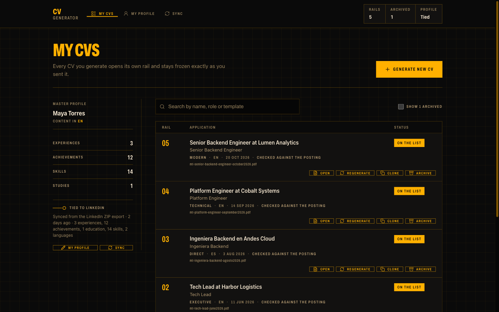
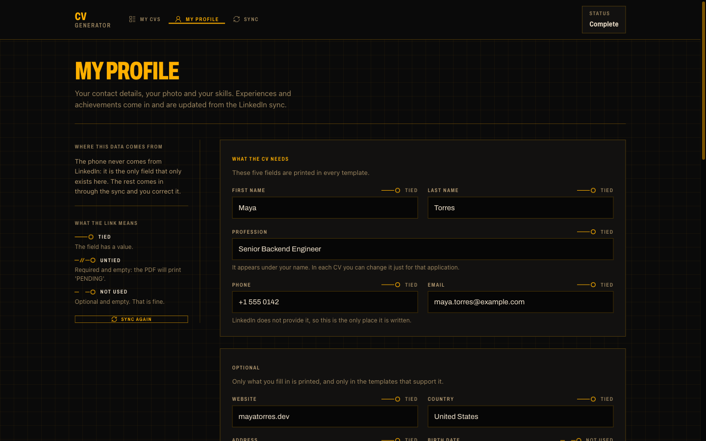
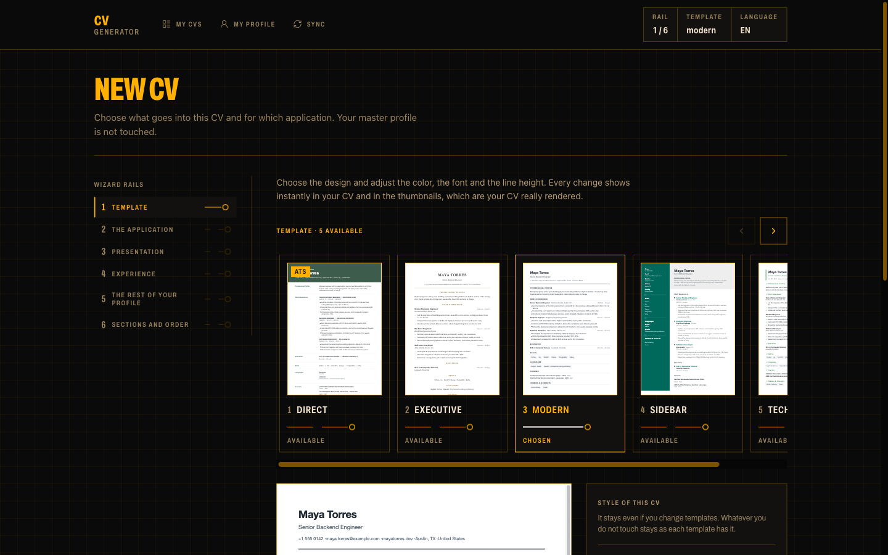
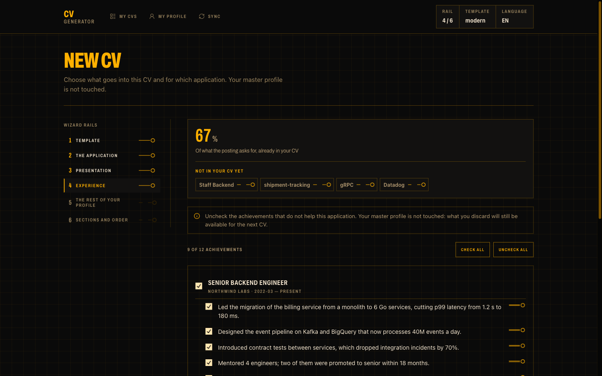
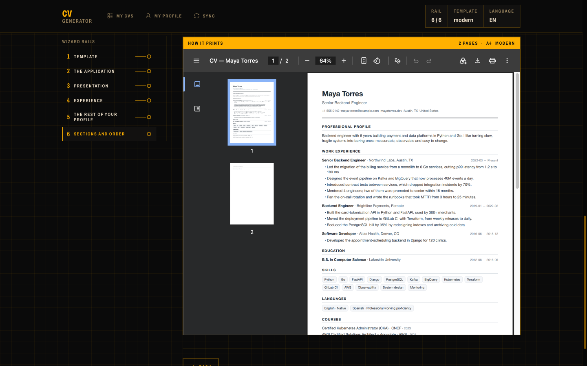
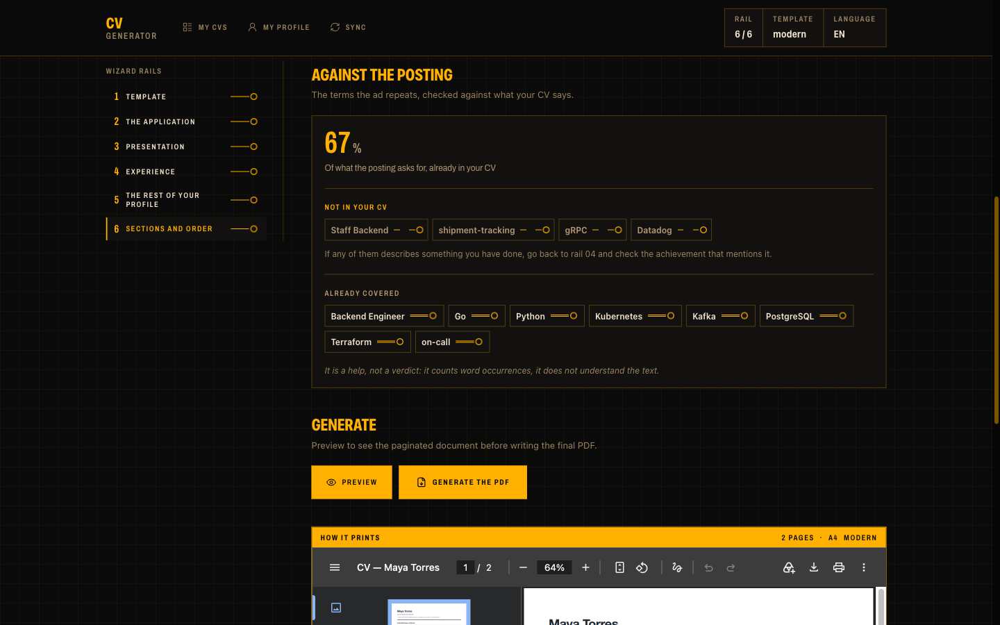
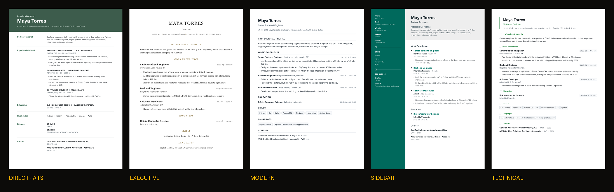

# CV Generator

[](https://www.python.org/)
[](https://reflex.dev/)
[](https://weasyprint.org/)
[](https://github.com/astral-sh/uv)
[](https://github.com/astral-sh/ruff)
[](LICENSE)
[](https://claude.com/product/claude-code)

A local application that generates PDF résumés **tailored to each job application**,
with an immutable history of what you actually sent.

The core idea: you write each achievement **only once** in your master profile and,
when creating a CV, you tick which ones go in depending on the job you are applying
for. The master profile is never modified, and every generated CV stays frozen exactly
as it was sent.



## Requirements

- [uv](https://docs.astral.sh/uv/getting-started/installation/), the Python package
  manager. It installs Python 3.12 for you if you do not have it.
- The native libraries [WeasyPrint](https://doc.courtbouillon.org/weasyprint/stable/first_steps.html)
  uses to draw the PDFs:

```bash
# macOS (Homebrew)
brew install pango

# Debian / Ubuntu
sudo apt install libpango-1.0-0 libpangoft2-1.0-0 libharfbuzz-subset0
```

On Linux, `curl` and `unzip` too: Reflex uses them to download bun, which runs the
interface.

On Windows, the simplest route is [WSL](https://learn.microsoft.com/windows/wsl/) with the
Debian / Ubuntu line above; for a native install, follow WeasyPrint's guide linked above.

## Installation

### Quick start

No terminal needed on macOS.

1. On GitHub, click **Code → Download ZIP**, then unzip it.
2. **macOS:** double-click `start.command`. The first time, macOS blocks it because it
   was downloaded. On macOS 14 or earlier, right-click it, choose **Open**, then **Open**
   again. On macOS 15 or later, go to **System Settings → Privacy & Security** and click
   **Open Anyway**. Only once.
3. **Linux:** open a terminal in the folder and run `./start.sh`. If it says
   "Permission denied", run `bash start.sh`.
4. Say yes to what it offers to install. First uv, the tool that downloads Python and the
   app's packages. Then, on macOS, Homebrew, which asks for your password, and Pango; on
   Linux, Pango, curl and unzip, with your password. The first start takes a few minutes
   (on a Mac without Homebrew, 10 to 20 more); the next ones take seconds, with no
   questions.
5. The browser opens on the app. If it does not, go to <http://localhost:3000>. To stop
   the app, close the window or press Ctrl+C. If something fails, `start.log` in the same
   folder says what happened.

If the app is already running, starting it again just opens the browser.

### For developers

```bash
git clone https://github.com/slackwero/cv-resume-generator.git
cd cv-resume-generator
uv sync
```

## Usage

The quick start above already runs the app. Developers start it in development mode:

```bash
uv run reflex run
```

Then open <http://localhost:3000>. The first start takes a minute or two while Reflex
installs the interface's dependencies; the next ones are quick.

Everything stays on your machine: your profile and your CVs are saved in `data/` and the
PDFs in `output/`, both excluded from git.

> [!WARNING]
> This app is meant to run only on your own computer, for one person. It has **no login**:
> whoever can talk to it can see and change your profile and your CVs. Do not deploy it
> to a public server.
>
> On your computer it protects itself: it only answers this computer (`localhost`), and it
> refuses requests from other websites open in your browser. In development mode
> (`uv run reflex run`), other computers on your network can still load the interface's
> code from port 3000, but not your data.
>
> Started with `start.command` or `start.sh`, the app runs in production mode on one
> port, behind that same protection: nothing in it, interface included, is reachable
> from other computers.

### Not yet tested on real hardware

CI starts the app from the ZIP GitHub serves on Ubuntu, macOS and Windows runners, in a
folder with a space and an accent, with Node.js hidden. It also starts it from scratch in
Ubuntu 24.04 and Fedora containers. What it cannot cover:

- The first double-click and Gatekeeper on a Mac that downloaded the ZIP.
- Installing Homebrew from nothing.
- Linux desktops: CI runs containers, not desktops.
- Distributions without apt or dnf. The launcher explains the manual steps.

If you can try one of these, the checklist is in [docs/manual-testing.md](docs/manual-testing.md).

### Your first CV

1. **Sync** — upload your LinkedIn data. The best source is the ZIP export
   (*Settings → Data privacy → Get a copy of your data*); the profile PDF
   (*More → Save to PDF*) works right away but is less complete. Review the proposed
   changes and apply them: this creates your master profile.
2. **My profile** — complete what LinkedIn does not provide (the phone, always), add the
   skills the PDF left out, and optionally upload a photo.
3. **New CV** — a six-step wizard: template, application, presentation, experience, rest
   of the profile, and sections. Preview the paginated PDF, then generate it.

<table>
  <tr>
    <td width="50%"><br>
      <sub><b>My profile.</b> What LinkedIn does not provide, like the phone.</sub></td>
    <td width="50%"><br>
      <sub><b>Step 1, template.</b> Every thumbnail is your own CV, really rendered.</sub></td>
  </tr>
  <tr>
    <td><br>
      <sub><b>Step 4, experience.</b> Untick the achievements that do not help this application.</sub></td>
    <td><br>
      <sub><b>Preview.</b> The paginated PDF, before you generate it.</sub></td>
  </tr>
</table>

The **Home** page lists every CV you generated, frozen exactly as you sent it, with the
option to open, regenerate, clone or archive each one.

The PDFs are generated in `output/` with the format `initials-role-monthyear.pdf`
(for example `jd-devsecops-march2026.pdf`). The month is written in the CV language.

The interface is in English. Each CV can be generated in English or Spanish: that
language sets the section titles, the month names and the contact labels printed in the
PDF. The content is whatever you wrote; the application does not translate text.

## Matching against the posting

In the application step you can paste the job ad's text. When you reach the end of the
wizard you will see which terms the posting asks for and which do not appear in your CV.



No language model or external service is involved: terms are extracted by their
**shape** and frequency. The main signal is capitalization in the middle of a sentence,
which tells a proper name (`Datadog`, `Kubernetes`) apart from a word that is
capitalized only by grammar (`Tools` at the start of a bullet). On top of that come
acronyms (`AWS`, `SAST`), inner capitals (`SonarQube`), technical symbols (`CI/CD`,
`Node.js`) and the words the ad repeats. The filler lists of each language (`we are
looking for`, `team`, `buscamos`, `equipo`…) live in `i18n/`.

It is a help, not a verdict: it counts word occurrences, it does not understand the text.

## About the LinkedIn integration

LinkedIn's official API **does not expose work experience**: the `r_basicprofile` and
`r_fullprofile` permissions are retired, and "Sign In with LinkedIn" only returns name,
email and photo. Reading positions, education and languages requires being an approved
Partner, which does not apply to a personal application.

That is why the data is imported from what LinkedIn does provide. There are two ways:

**ZIP export** (recommended) — *Settings → Data privacy → Get a copy of your data*. A
ZIP arrives by email with one CSV per section (`Positions.csv`, `Education.csv`,
`Skills.csv`…). The data comes structured, so each field is read from its column, with
no guessing. It takes from minutes to a day to arrive.

**Profile PDF** — *More → Save to PDF*. Immediate, but the PDF has no structure: it is
text with breaks by column width and page markers in between. The parser anchors on
the date lines, which are the only unmistakable signal, and works out the rest around
them. It understands LinkedIn's English and Spanish headings. It is best-effort: review
the result before applying it.

A third importer that automated the browser was ruled out: it is the only one that
risks an account restriction and the most fragile to maintain, and the two ways above
cover the case.

## How the sync works

Syncing never overwrites or deletes: it proposes changes and you decide. Each achievement
keeps the text as it came from LinkedIn (`imported_value`), which lets it tell four
situations apart:

| Your text | What arrives | Result |
|---|---|---|
| = origin | = origin | unchanged |
| = origin | ≠ origin | changed on LinkedIn, proposed already checked |
| ≠ origin | = origin | you edited it, it is respected |
| ≠ origin | ≠ origin | **conflict**, arrives unchecked and you decide |

The achievements you add or duplicate in My profile never take part: the sync only
compares against the ones that came from LinkedIn. One you delete is remembered, so the
sync does not offer it again.

## Templates

Five designs in `templates/`. Three are single-column, one per typographic voice:
`modern` (sans, quick read), `executive` (serif, centered, lots of whitespace) and
`technical` (monospace metadata and a green accent). `sidebar` has two columns: a color
bar with the photo, the contact details, the skills and the languages, and the body with
the profile text and the work history. `direct` puts the name in a color band and each
section in a row with its title on the left.



`direct` is the template meant for ATS filters, and it declares `"ats": true` in its
`meta.json`: the step 1 carousel gives it an "ATS" badge. An ATS template carries no
photo (the test contract requires it), its HTML is a single reading line and its section
titles fit on one line, because split in two a filter reads them as two labels. Every
template passes the ATS-readable text test; the badge marks the one that was also
designed for it.

There used to be six, but four shared the font stack and the structure: at thumbnail
size they could not be told apart, so choosing between them meant paying the cost of
the decision without getting the information to make it.

Adding a template is adding a folder with `meta.json`, `template.html` and `styles.css`.
The `meta.json` has to declare `line_height`, the `line-height` of its `body`: the
wizard's line height control starts from that value, and without it the wizard does not
open. The markup is shared from `templates/_macros.html`, so in practice only the CSS is
written, unless the structure changes, as in the two columns of `sidebar`. No template
writes section labels: it always prints `section.title`, which the user customizes. The
few words of their own (the "Present" of a current job, the contact labels of
`sidebar`) come from `i18n/`, in the CV language.

For two columns in WeasyPrint, the CSS grid (`display: grid`) is what splits the content
across pages. With flexbox or `float` the body went whole to page 2 or got lost.

### Style variables

Each CV can change its template's color, font, font size and line height. The template
is not rewritten: the render appends after its CSS a `:root` block that overrides only
what was chosen, and everything else keeps the template's value. That is why an
uncustomized CV comes out identical to how it came out before this option existed.

For that to work, each template declares these variables in its own `:root`, with its
usual values, and uses them instead of literals:

| Variable | Own value | Where it is used |
|---|---|---|
| `--accent` | the template's color | whatever should take the chosen color: titles, rules, bullets |
| `--heading-font` | its heading stack | the name, the section titles and each entry's title |
| `--body-font` | its text stack | the `body`'s `font-family` |
| `--scale` | `1` | every size, like `calc(10pt * var(--scale))`; margins and spacing do not scale |
| `--line-height` | the `line_height` of its `meta.json` | the `body`'s `line-height` |
| `--entry-break` | `avoid` | the `break-inside` (and `page-break-inside`) of `.entry` |
| `--break-after-header` | `auto` | the `break-after` (and `page-break-after`) of `.entry__header` |

The user does not choose the two break variables: the render writes them when the CV
changes the font, the size or the line height, which move where each line falls (small
text shortens the text, but a wider font lengthens it). A long entry that cannot be split
jumps whole to page 2 and leaves page 1 with only the header; with those two the entry
splits between achievements and its header stays with the first one. With no style, or
with only a color, they keep the values above, which is how the CVs already generated
were paginated.

On screen (the large view and the step 1 thumbnails) the browser ignores `@page`, so
each template repeats its page margins in `@media screen { body { padding } }`.
WeasyPrint paginates with the `print` medium and does not read it.

Declaring them is not enough: `tests/test_templates.py` renders each template with
another color and another font and checks that what is drawn changes.

A template that paints a color block with text on it, like the `sidebar` bar, also uses
`--background` and `--tint` (and `--rule` for the lines): every palette color brings
them with AA contrast.

`tests/test_template_contrast.py` measures, with the template as is and with every
palette color, the rules whose selector starts with a class or an id (`.` or `#`) and
give text a `color`. The background it measures against is the rule's own `background`
or, if it paints none, that of the closest ancestor that appears in the selector itself
and paints one; if there is none, the white paper. It does not know the document tree,
so text on a painted background has to name that container in the selector
(`.sidebar .section__title`). In those rules, `color` and `background` carry a hex or a
plain `var(--x)`, with no fallback value: any other form of `var()` makes the test fail
instead of taking the rule out of the measurement, but a color name (`white`) or an
`rgb()` is not read and the rule is left unmeasured. Neither `body`, element selectors
nor `@page` are measured: the `sidebar` `@page` gradient, which paints the bar with
`var(--background)` inside `linear-gradient`, stays out of the measurement.

A typeface of its own that the font selector must not change goes in a separate
variable, outside the contract. `technical` keeps its monospace (profession, contact,
section titles, dates, tags) in `--data-font`, which the selector never writes; that is
why its section titles do not use `--heading-font`.

### The photo

It is uploaded in **My profile** and stored embedded, as a base64 JPEG, in the profile
and in every history snapshot: changing it later does not alter a CV already sent. It
accepts JPG (also the one from a phone with HDR, which Pillow reads as MPO) and PNG. On
upload it is straightened, cropped to 3:4, downscaled to 450×600 and stripped of its
EXIF metadata, which can carry the GPS location, and of the image comment. Only the
templates with `supports_photo: true` in their `meta.json` (`modern` and `sidebar`) draw
it, and in step 2 of the wizard you choose whether it goes in that CV. If the profile has
no photo yet, step 2 opens My profile in another tab (going back to `/new` would restart
the wizard) and "I uploaded it" brings the photo in without touching anything else.

Every template must pass the contract in `tests/test_templates.py`, which checks among
other things that the PDF text stays **readable by an ATS** (a high `letter-spacing`
makes the extractor return `C A R E E R` and no automated filter recognizes the
section).

## Data

Everything is stored as JSON, with no database engine:

```
data/profile.json      master profile (source of truth)
data/sync_state.json   last sync
data/history.json      history index (a cache, except for what you archived)
data/cvs/<id>.json     frozen snapshot of each generated CV
output/                the PDFs
```

The index can be rebuilt by reading the snapshots, with one exception: what you decide
**after** generating —archiving a CV, when and why— is in no snapshot. Rebuilding
combines both instead of redoing everything, because recomputing that would erase it.

These files contain personal data and are excluded from git.

## Development

```bash
uv run pytest              # tests
uv run ruff check .        # lint
uv run ruff format .       # format
```

Two records go with the code and are worth reading before touching it:

- **`PRODUCT.md`** — what this product is, who it is for, and which constraints cannot
  be broken (LinkedIn's text goes in as is; the PDF has to stay readable by an ATS; no
  database and no external services).
- **`DESIGN.md`** — the interface's visual system, written from what was built and not
  from the intention. The law that governs it: state is carried by the stroke pattern,
  never by color.

## Built with Claude Code

This application was generated with [Claude Code](https://claude.com/product/claude-code),
Anthropic's AI coding tool.

## License

[MIT](LICENSE): free to use, modify and share.
